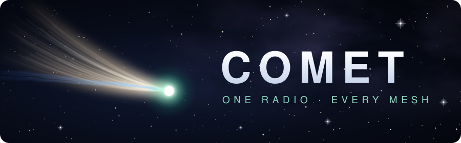

<p align="center">
  
</p>

<p align="center"><b>One radio, every mesh.</b> &middot; open source &middot; GPL-3.0</p>

<p align="center">
  
  
  
</p>

**Comet** is firmware for LoRa handhelds that turns them into an always-with-you
off-grid device: mesh messaging, offline maps, an e-reader and audiobook player,
and later SMS and calls over the built-in modem. You pick which mesh is active
from one app screen.

Today it speaks [MeshCore](https://github.com/meshcore-dev/MeshCore). Meshtastic
and other meshes are on the roadmap.

> Comet is a fork of [wadamesh](https://github.com/ALLFATHER-BV/wadamesh), which
> itself grew out of [meshcomod](https://github.com/ALLFATHER-BV/meshcomod). It
> is an independent project and not affiliated with wadamesh, MeshCore,
> Meshtastic or LilyGo.

## Boards

| Board | Status | PlatformIO env |
|---|---|---|
| LilyGo T-Deck Max (e-paper, A7682E modem) | main target | `LilyGo_TDeck_Max_companion_radio_touch` |
| LilyGo T-LoRa Pager (SX1262 / LR1121) | supported | `tlora_pager_sx1262_companion_radio_touch` / `tlora_pager_lr1121_companion_radio_touch` |

More boards will follow once the multi-mesh core is in place.

## What works

- **MeshCore**: chats, channels, contacts, map, settings, the companion app over
  BLE, Wi-Fi or USB
- **Books**: an EPUB/TXT reader with remembered text size, and an
  [Audiobookshelf](https://www.audiobookshelf.org/) client for e-books and
  audiobooks, which can be streamed, downloaded for offline listening or copied
  to the SD card as a folder of MP3s
- **USB Files**: browse, upload and download the SD card from a browser over
  the USB cable
- **T-Deck Max**: tuned e-paper (contrast, periodic full refresh), keyboard and
  touch, haptics, audio with a usable volume curve, and Wi-Fi and Bluetooth that
  hand over cleanly

## Roadmap

- **Multi-mesh**: MeshCore and Meshtastic on one radio, with a selector for the
  active mesh
- **Modem (T-Deck Max)**: SMS, voice calls and mobile data on the A7682E
- **New framework base** (in progress, [idf/](idf/)): ESP-IDF 5.5 with
  arduino-esp32 3.3, with network and TLS buffers sized and placed for far more
  free internal RAM and faster transfers
- **USB mass storage**: the SD card as a drive on your computer
- **More boards**

## Flashing

There are no releases yet. Builds come from GitHub Actions as artifacts.

Update an existing install (keeps your settings):

```bash
esptool --chip esp32s3 --port <PORT> write-flash 0x10000 firmware.bin
```

A first install uses the merged image at `0x0`, which also erases the device's
settings.

## Building

[PlatformIO](https://platformio.org/) fetches the MeshCore core fork and all
libraries:

```bash
pio run -e LilyGo_TDeck_Max_companion_radio_touch
pio run -e tlora_pager_sx1262_companion_radio_touch
```

The ESP-IDF 5.5 build that will replace it lives in [idf/](idf/README.md):

```bash
idf/fetch-deps.sh && idf/build.sh tdeck_max
```

## Credits

Comet stands on the work of others:

- **wadamesh** by Kaj Schittecat and the wadamesh contributors (GPL-3.0): the
  touch UI this project is built on
- **MeshCore** by Scott Powell / rippleradios.com and contributors (MIT): the
  mesh core, built through **meshcomod**, the MeshCore fork wadamesh uses (MIT)
- **LVGL**, **ArduinoJson**, **minimp3**, **miniz** and the other libraries
  listed in [NOTICE](NOTICE)

## License

**GPL-3.0-or-later**: see [LICENSE](LICENSE). Anyone who distributes a build
or a fork must also make its source available under the GPL. MeshCore-derived
files keep their MIT notices; see [NOTICE](NOTICE) for every component and its
license.
